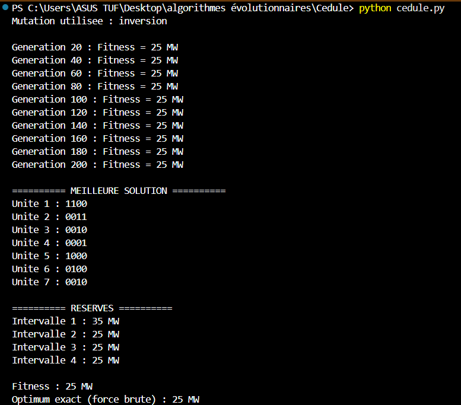

# Ordonnancement de la maintenance de centrales électriques par Algorithme Génétique

Projet réalisé dans le cadre du cours d'**Algorithmes génétiques** (LSI 3).
Le programme Python cherche une cédule de maintenance qui **maximise la puissance en réserve** pendant l'année.

## 1. Description du problème

Sept centrales électriques doivent subir une maintenance préventive. L'année est découpée en **4 intervalles**.

| Unité | Capacité (MW) | Nb d'intervalles de maintenance |
|:-----:|:-------------:|:-------------------------------:|
| 1 | 20 | 2 |
| 2 | 15 | 2 |
| 3 | 35 | 1 |
| 4 | 40 | 1 |
| 5 | 15 | 1 |
| 6 | 15 | 1 |
| 7 | 10 | 1 |

- Capacité totale : **150 MW**
- Demande par intervalle : **80, 90, 65 et 70 MW**

**Contraintes**
- La maintenance d'une unité commence au début d'un intervalle et se termine à la fin d'un intervalle.
- Les intervalles de maintenance d'une même unité sont consécutifs.
- La réserve doit rester positive dans chaque intervalle.

## 2. Formulation

**Réserve** de l'intervalle *t* :

```
R(t) = Capacité_totale − P_perdue_maintenance(t) − Demande(t)
```

**Fonction objectif** (à maximiser) :

```
Fitness = min( R(1), R(2), R(3), R(4) )      (Fitness = 0 si une réserve est négative)
```

## 3. Codage du chromosome

- Un chromosome est composé de **7 gènes de 4 bits** (un gène par unité).
- Chaque bit représente un intervalle : `1` = maintenance, `0` = pas de maintenance.
- Motifs possibles :
  - Unités 1 et 2 : `1100`, `0110`, `0011`
  - Unités 3 à 7 : `1000`, `0100`, `0010`, `0001`

Exemple : `0110 0011 0001 1000 0100 0010 1000`

## 4. Algorithme génétique

| Élément | Choix |
|---|---|
| Population initiale | 49 chromosomes (7 × 7 variables), générés aléatoirement avec des motifs valides |
| Sélection | **Loterie (roulette)** : tirage d'un nombre entre 0 et la somme des fitness, puis parcours des fitness cumulées |
| Croisement | 1 point, **uniquement entre deux gènes** (PC = 0,8) |
| Mutation (principale) | **Inversion** : les bits d'un gène sont inversés, par exemple `1100 → 0011` (PM = 0,2) |
| Mutation (variante) | **Remplacement** : le gène est remplacé par un autre motif valide de la même unité |
| Élitisme | Le meilleur chromosome est conservé à chaque génération |
| Arrêt | 200 générations |

Le croisement et la mutation agissent sur des **blocs de 4 bits** : toutes les cédules générées restent valides.
La mutation par inversion conserve le nombre de `1` et leur contiguïté. Un gène palindrome (`0110`) n'est pas modifié.

## 5. Structure du code

| Fonction | Rôle |
|---|---|
| `generer_chromosome()` / `generer_population()` | Création de la population initiale |
| `calculer_reserves()` | Calcul de la réserve pour chaque intervalle |
| `fitness()` | Plus petite réserve (0 si négative) |
| `selection_loterie()` | Sélection par roulette |
| `croisement()` | Croisement à un point entre deux gènes |
| `mutation_inversion()` / `mutation_remplacement()` | Les deux types de mutation |
| `mutation()` | Choisit la mutation selon `TYPE_MUTATION` |
| `algorithme_genetique()` | Boucle principale |
| `afficher_solution()` | Affichage du meilleur résultat |
| `optimum_exact()` | Vérification par force brute (9216 combinaisons) |


## 7. Résultats


